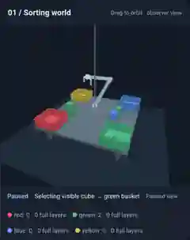
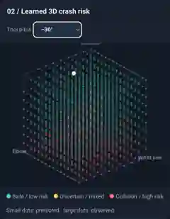
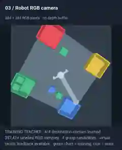

# NTRAM – Neurally Trained Robot Arm Model

NTRAM is an open-source experimental robot arm simulator written in HTML and JavaScript. It explores how a robot can learn to recognise coloured cubes and avoid collisions using a camera and neural networks.

[Open the simulator](https://rickey1990.github.io/NTRAM-Neurally-Trained-Robot-Arm-Model/), or download `index.html` and open it in your browser.

## How it works

- **Simulation teacher:** During training, the simulator identifies the correct basket and uses virtual touch to record safe movements and collisions.
- **Pixel vision:** A single 384 × 384 RGB camera provides images without a depth sensor. A learned classifier associates pixel colours with the correct basket.
- **Movement learning:** Two neural networks learn collision risks and rank possible grasp-and-place movements from camera features and joint positions. Both safe and unsafe movements provide learning data.
- **Crash map:** Green shows low risk, yellow shows uncertainty and red shows high risk. Large dots are observed results; small dots are predictions.
- **Independent testing:** The robot uses its learned vision and movement scores without teacher colour lookup, virtual touch feedback or changes to its learned weights. A collision ends the test.
- **Sorting challenge:** The robot sorts cubes into four matching baskets, stacking them in layers of four without disturbing the towers.

## Screenshots

### Sorting world

### Learned 3D crash map

### Robot RGB camera

## Using NTRAM

Select a difficulty, press **Start training**, then press **Test learned vision** to see how the robot performs using its learned knowledge. Training runs at high speed with snapshots every five seconds; testing runs slowly.

## Prototype limitations

Physics, camera calibration, geometry extraction, fixed basket positions and movement generation are programmed. The networks learn vision associations and movement scores, not direct motor control. Real-world robotic performance and safety have not been established.

## Licence

[MIT License](LICENSE) — free to use and modify under the licence terms.

Contact: rickeyernest1990@gmail.com
